<div align="center">

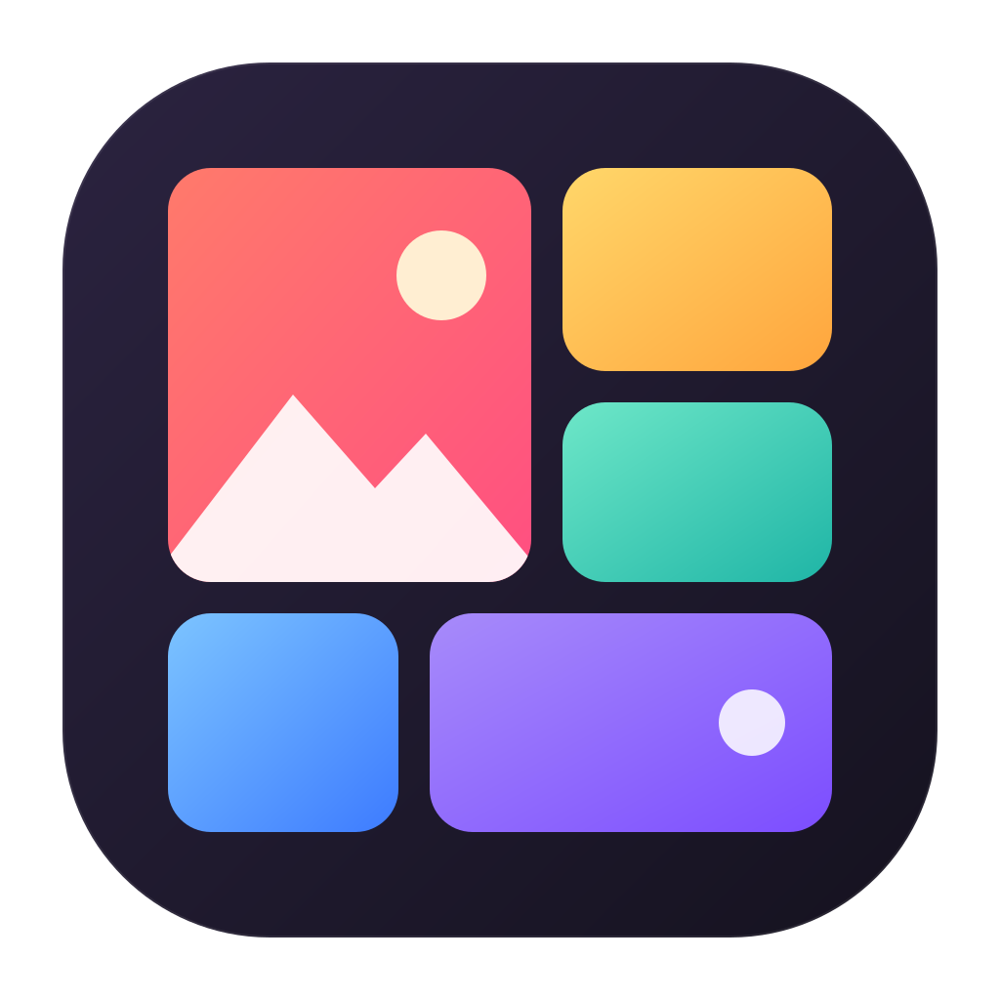

# Tessera

**A creative photo collage studio and an image Swiss Army knife.**

Quick automatic collages, hand-crafted designs and templates for every occasion —
plus a converter and a smart compressor that keep the metadata you care about.
Free and open source. No accounts, no watermarks, no paywall.

[](https://github.com/MrNechev/tessera/actions/workflows/ci.yml)
[](https://github.com/MrNechev/tessera/releases)
[](LICENSE)

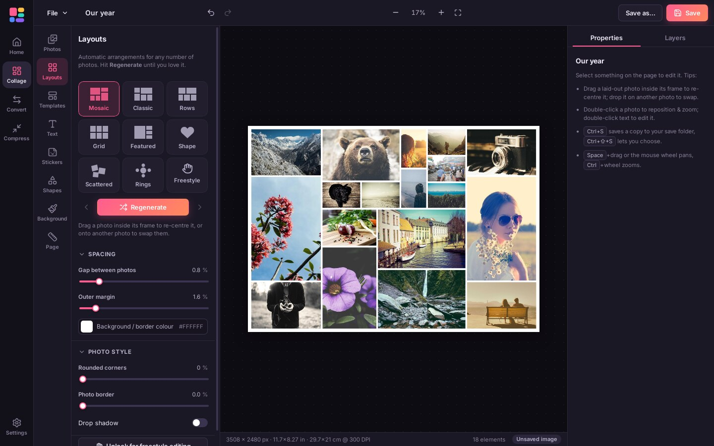

</div>

> A *tessera* is a single tile of a mosaic — and in a collage, every photo is one.

> [!NOTE]
> Tessera is in **alpha**. Everything described below works, but expect rough
> edges, and keep your original photos (Tessera never modifies them unless you
> explicitly choose “Replace” in the converter).

## What it does

### Collages

| Simple & automatic | Hand-crafted | From a template |
| :---: | :---: | :---: |
| 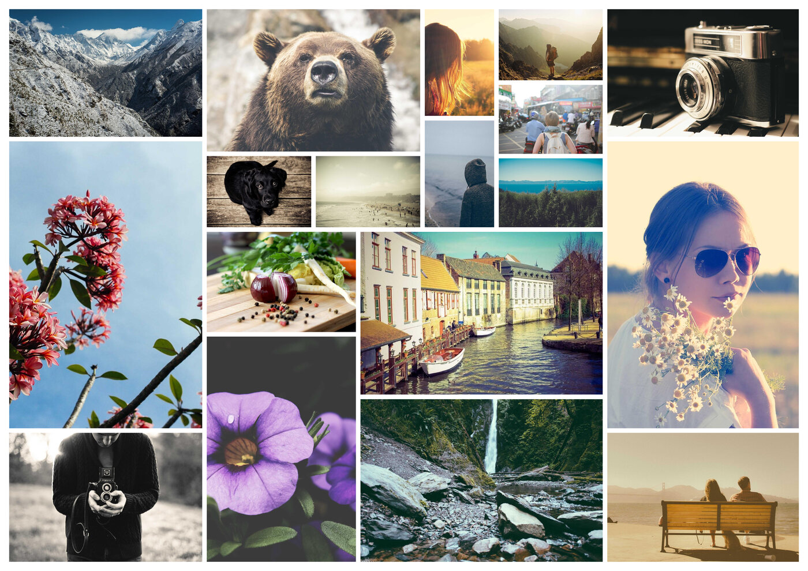 | 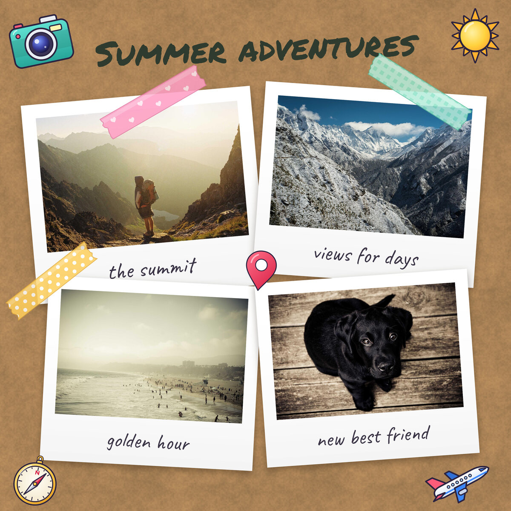 | 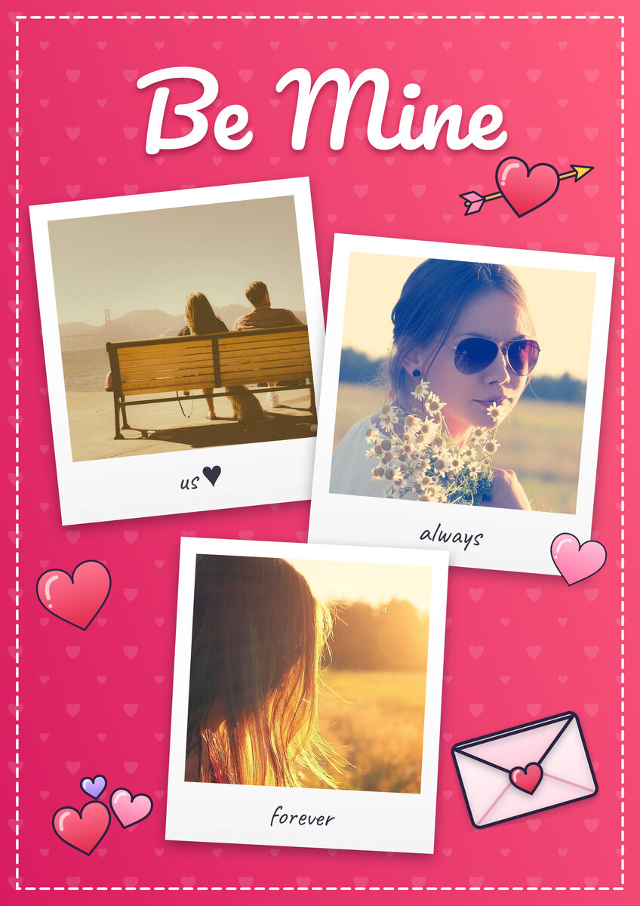 |
| **Heart of Us** (shape layout) | **Merry Christmas** (template) | **Photo Calendar** (template) |
| 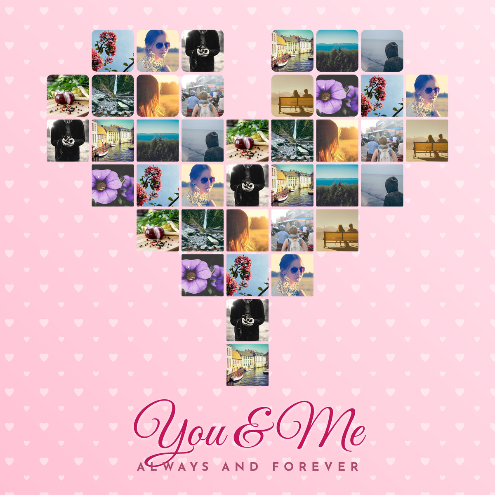 | 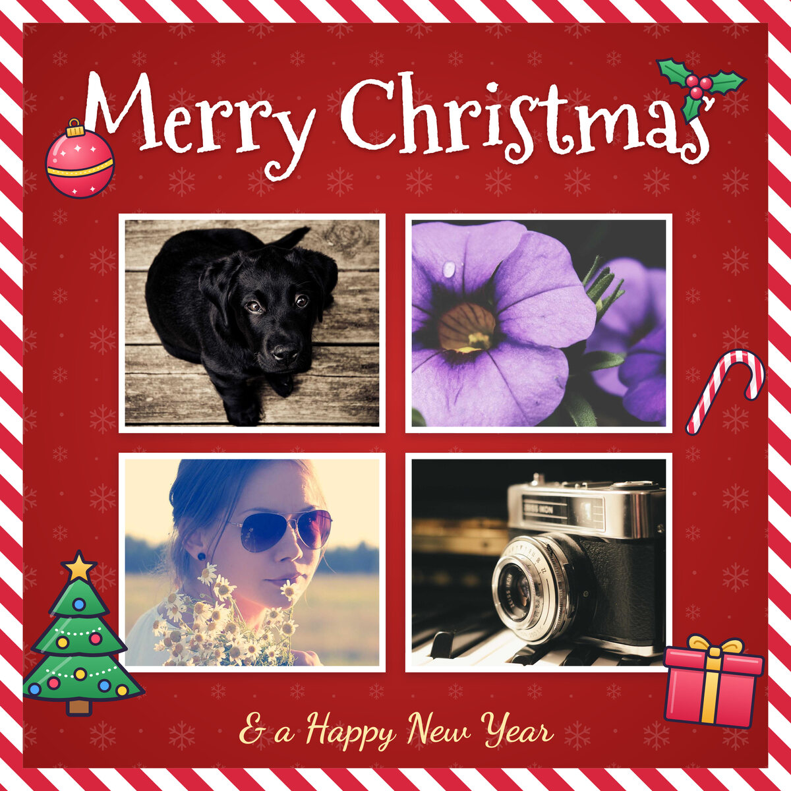 | 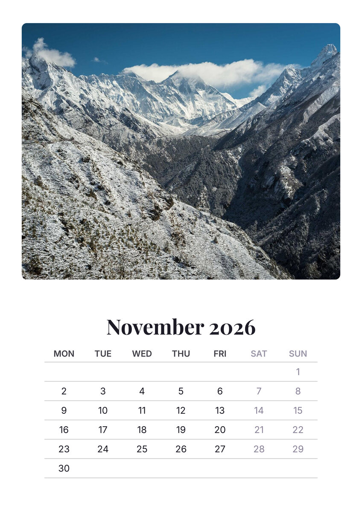 |
| **L-O-V-E** (letters layout) | **The Big Number** (letters layout) | |
| 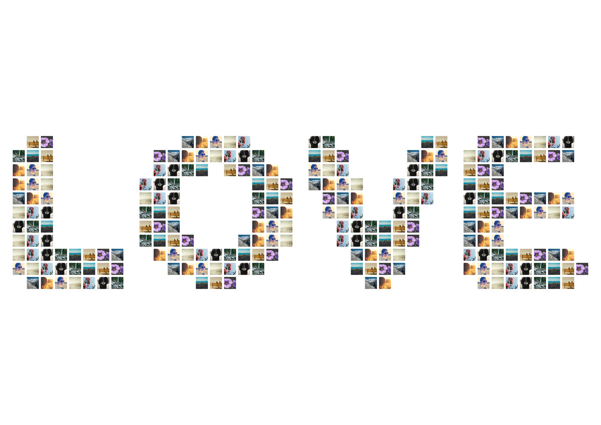 | 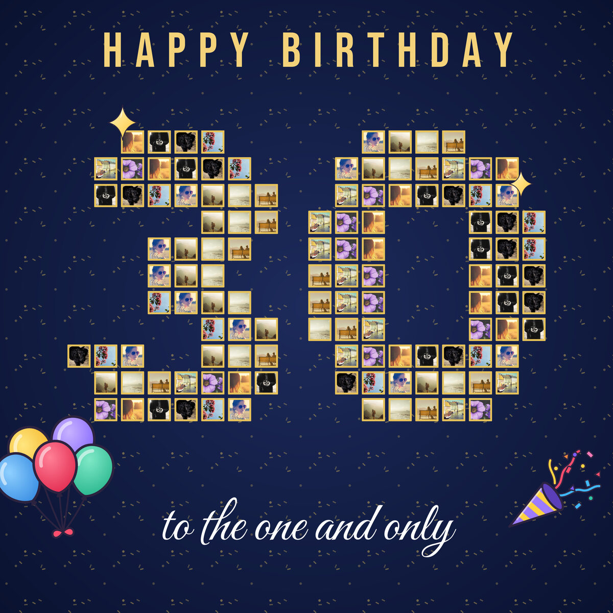 | |

- **Quick collage** — pick any number of photos (dozens or hundreds) and get a
  layout that fills the page. Press **Regenerate** until you love it, and step
  back and forth through previous layouts.
- **Ten layout engines** — *Mosaic* (fills edge to edge with minimal cropping),
  *Classic* (a faithful port of [PhotoCollage](https://github.com/adrienverge/PhotoCollage)’s
  column algorithm), *Rows*, *Grid*, *Featured*, *Shape* (heart, circle, star,
  hexagon, diamond), *Letters* (photos fill any word, name or number),
  *Spiral*, *Scattered polaroids* and *Rings*.
- **Fix it by hand, PhotoCollage-style** — drag a photo inside its frame to
  re-centre it; drop it on another photo to swap them; double-click to zoom and
  reposition.
- **A real editor** — move, resize and rotate anything with snapping guides,
  layers, alignment, undo/redo, copy & paste and keyboard shortcuts.
- **Photo styling** — 14 frame shapes (heart, arch, circle, scallop, cloud…),
  polaroid / instant / film / mat / tape frames with captions, borders, soft
  shadows, filters (B&W, vintage, warm, dreamy…) and adjustments.
- **Text** — 26 bundled fonts (script, handwriting, display, serif…), outline,
  shadow, label backgrounds and **curved text**.
- **Calendars** — add any month with marked birthdays and holidays, or all
  twelve months at once, in four styles; photo-calendar templates included.
- **259 original stickers** — hearts, Christmas, New Year, birthday, Halloween,
  Easter, wedding, baby, graduation, travel, nature, pets, emoji-style faces,
  scrapbook doodles, gold balloon numbers, sports, music, food, space, kids,
  flowers, seasons and animals.
- **Backgrounds** — colours, gradients, 16 patterns, paper textures, a blurred
  photo, vignette and decorative page borders (stitched, candy cane, hearts,
  snowflakes, gold, film strip…).
- **58 templates** for Valentine’s Day and loved ones, anniversaries, Christmas,
  New Year, birthdays, Mother’s and Father’s Day, weddings, new babies, travel,
  Halloween, Easter, autumn, spring, graduation, friends, pets, calendars,
  letters and numbers, and a baby’s first year.
- **Print-ready sizes** — A3, A4, A5, US Letter/Legal, photo prints (4×6″, 5×7″…),
  scrapbook 12×12″ at 72–600 DPI, plus social-media and screen sizes.

### Saving

- **Save** (<kbd>Ctrl</kbd>+<kbd>S</kbd>) writes a copy of your collage into your
  save folder (default: `~/Pictures/Tessera`) — no dialog.
- **Save as…** (<kbd>Ctrl</kbd>+<kbd>Shift</kbd>+<kbd>S</kbd>) lets you choose
  the location, file name, format (JPEG, PNG, WebP, AVIF, TIFF or PDF), quality
  and size. The print DPI is embedded in the file.
- Projects autosave and appear under **Recent** on the home screen; you can also
  save `.tessera` project files anywhere.

### Image tools

- **Convert** between JPEG, PNG, WebP, AVIF, TIFF, BMP, GIF, QOI, ICO and TGA
  (and import HEIC/HEIF, JPEG XL and **camera RAW** files).
  - **RAW:** CR2, CR3, NEF, ARW, DNG, RAF, ORF, RW2, PEF and many more open
    everywhere in Tessera — in collages, the converter and the compressor —
    developed with the camera's white balance and colour matrix.
  - **Colour management:** wide-gamut photos (Display P3 from phones, Adobe RGB
    from cameras) are converted to sRGB through their ICC profile, so they look
    right on every screen and website. Or keep the original profile.
  - **Quality:** keep **100 %** (lossless wherever the format allows — a
    JPEG→JPEG copy never touches the image data) or **lower it by any percentage**.
  - **Metadata:** keep everything, remove everything, or choose: date & time,
    camera / phone, camera settings, location (GPS), author & copyright, colour
    profile, and the file’s modified date.
- **Compress** with a before/after preview:
  - **Smart — visually lossless:** finds the smallest file that still measures as
    identical to the original (SSIM-based search). Typical camera JPEGs shrink
    to around 40 % of their size.
  - Balanced, Small, Lossless-only, custom quality, or **fit under a target file
    size**; optional resize and format change (WebP/AVIF are much smaller).

### Screenshots

| | |
| :---: | :---: |
| 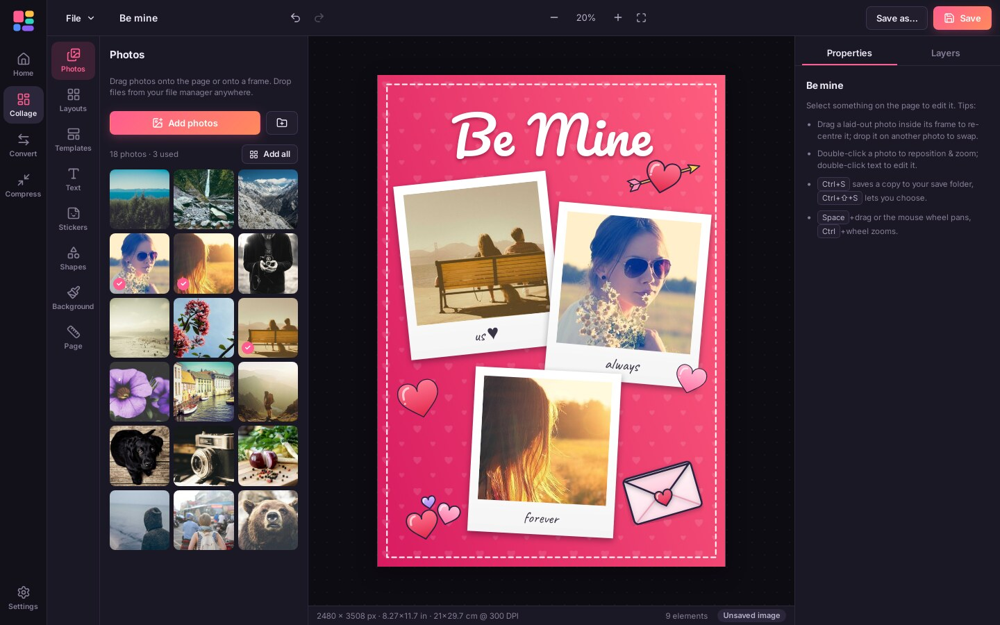 | 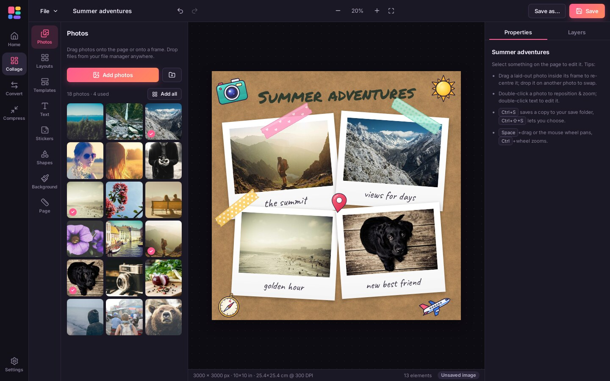 |
| 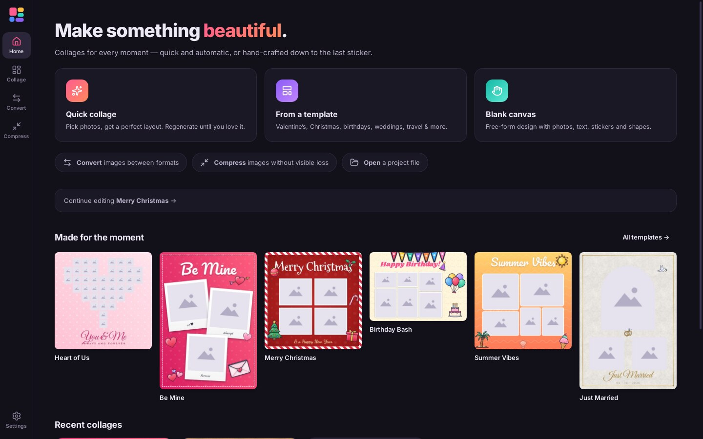 | 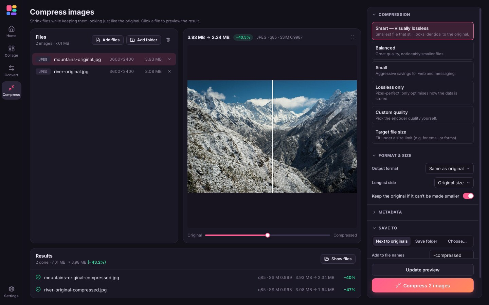 |

## Install

Download the latest file for your system from the
[**Releases** page](https://github.com/MrNechev/tessera/releases).

| System | File | How |
| --- | --- | --- |
| Fedora, openSUSE, RHEL | `.rpm` | `sudo dnf install ./Tessera-*.rpm` |
| Debian, Ubuntu, Mint, Pop!_OS | `.deb` | `sudo apt install ./Tessera_*.deb` |
| Any distribution (sandboxed) | `.flatpak` | `flatpak install --user Tessera_*.flatpak` |
| Any distribution (portable) | `.AppImage` | `chmod +x Tessera_*.AppImage && ./Tessera_*.AppImage` |

The deb, rpm and AppImage need a reasonably recent system (Ubuntu 24.04,
Debian 13, Fedora 40 or newer). The Flatpak runs everywhere Flatpak does.

**HEIC/HEIF photos** (from iPhones) need an HEVC decoder:

- **Flatpak** — included, works out of the box.
- **.deb** — installs `libheif-plugin-libde265` automatically (it's a recommended package).
- **.rpm** — Fedora's libheif has no HEVC decoder for patent reasons; install
  `libheif-freeworld` from RPM Fusion (Bazzite and many Fedora spins already have it).
- **AppImage** — can't open HEIC yet in 0.1.0 (the decoder plugin isn't bundled);
  use the Flatpak, or convert HEIC photos first. This is fixed in the next release.

### Updates

Tessera checks GitHub for new releases once a day (you can turn this off in
Settings; nothing about you or your computer is sent). The Flatpak is updated by
your software centre instead. In-place automatic updates for the AppImage are
planned.

## Using Tessera

| Action | How |
| --- | --- |
| Re-centre a photo in its frame | Drag it inside the frame, or double-click and drag; scroll to zoom |
| Swap two photos | Drag one onto the other (hold <kbd>Alt</kbd> for free-standing photos) |
| New arrangement | **Regenerate** or <kbd>Ctrl</kbd>+<kbd>R</kbd> — arrows go back/forward |
| Edit text | Double-click it; <kbd>Esc</kbd> when done |
| Move precisely | Arrow keys (with <kbd>Shift</kbd> for bigger steps) |
| Rotate in 15° steps | Hold <kbd>Shift</kbd> while dragging the round handle |
| Pan / zoom the canvas | <kbd>Space</kbd>+drag or scroll / <kbd>Ctrl</kbd>+scroll |
| Undo / redo | <kbd>Ctrl</kbd>+<kbd>Z</kbd> / <kbd>Ctrl</kbd>+<kbd>Shift</kbd>+<kbd>Z</kbd> |
| Duplicate / delete | <kbd>Ctrl</kbd>+<kbd>D</kbd> / <kbd>Del</kbd> |
| Bring forward / send back | <kbd>Ctrl</kbd>+<kbd>]</kbd> / <kbd>Ctrl</kbd>+<kbd>[</kbd> |
| Fit / 100 % | <kbd>Ctrl</kbd>+<kbd>0</kbd> / <kbd>Ctrl</kbd>+<kbd>1</kbd> |

Drop image files or folders anywhere on the window: onto the collage, the
converter or the compressor. You can also open images with Tessera from your
file manager.

## Building from source

You need Node.js 22+, a recent stable Rust toolchain and the Tauri 2 Linux
prerequisites plus libheif and dav1d:

```bash
# Fedora
sudo dnf install webkit2gtk4.1-devel gtk3-devel libsoup3-devel librsvg2-devel \
  libheif-devel libdav1d-devel nasm openssl-devel
# Debian / Ubuntu
sudo apt install libwebkit2gtk-4.1-dev libgtk-3-dev libsoup-3.0-dev librsvg2-dev \
  libheif-dev libdav1d-dev nasm build-essential

npm ci
npm run tauri dev        # run with hot reload
npm run tauri build      # build deb, rpm and AppImage into target/release/bundle
```

The Flatpak is built from [`packaging/flatpak`](packaging/flatpak). See
[CONTRIBUTING.md](CONTRIBUTING.md) for tests and project conventions and
[docs/ARCHITECTURE.md](docs/ARCHITECTURE.md) for how the pieces fit together.

## Roadmap

Priorities for the next releases, in order:

1. ✅ **More templates, stickers and layouts** — photos arranged into letters,
   numbers and words; photo calendars; new occasions and sticker sets (0.2.0).
2. ✅ **RAW camera formats and colour management** (ICC conversion) (0.3.0).
3. **Batch watermark, resize and rename tools.**
4. **Printing and multi-page projects** (photo books, calendars).
5. Bug fixing, polish and performance across all of the above.

Planned for later: in-app updates for the AppImage, a Flathub listing,
translations, and Windows and macOS builds.

Ideas and bug reports are very welcome — [open an issue](https://github.com/MrNechev/tessera/issues).

## License & credits

Tessera is free software: you can redistribute it and/or modify it under the
terms of the [GNU General Public License v3](LICENSE) or (at your option) any
later version.

- The stickers, patterns and templates are original works dedicated to the
  public domain ([CC0 1.0](public/stickers/LICENSE.md)), so everything you make
  with them is entirely yours.
- Fonts are licensed under the SIL Open Font License 1.1 or Apache 2.0 — see
  [`public/fonts/licenses`](public/fonts/licenses).
- The *Classic* layout is a port of the algorithm from
  [PhotoCollage](https://github.com/adrienverge/PhotoCollage) by Adrien Vergé
  (GPL-2.0-or-later), which inspired this project.
- Sample photos in the screenshots are from [Unsplash](https://unsplash.com)
  via [Lorem Picsum](https://picsum.photos).
- Built with [Tauri](https://tauri.app), [Svelte](https://svelte.dev),
  [mozjpeg](https://github.com/mozilla/mozjpeg), [libwebp](https://chromium.googlesource.com/webm/libwebp),
  [rav1e](https://github.com/xiph/rav1e), [oxipng](https://github.com/shssoichiro/oxipng),
  [libimagequant](https://pngquant.org/lib/), [libheif](https://github.com/strukturag/libheif),
  [jxl-oxide](https://github.com/tirr-c/jxl-oxide), [rawler](https://github.com/dnglab/dnglab)
  (LGPL-2.1, camera RAW), [moxcms](https://github.com/awxkee/moxcms) (colour management)
  and [Lucide](https://lucide.dev) icons.
