<div align="center">

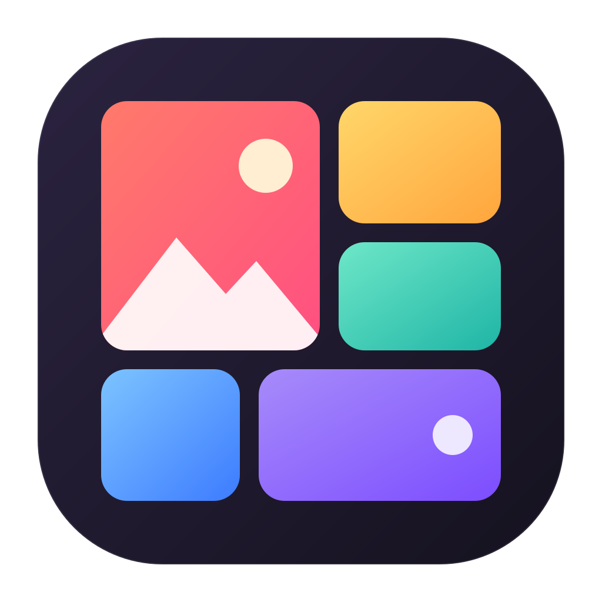

# Tessera

**A creative photo collage studio, an image Swiss Army knife, and a home for your photo and video library.**

Quick automatic collages, hand-crafted designs and templates for every occasion;
a converter and a smart compressor that keep the metadata you care about; and a
media library with stories — diaries, trips, chronicles — a canvas and
presentations made from the photos and videos already in your folders. One
photo toolkit (filters, adjustments, crops, frames, cut-outs) works in every
editor.
Install it as a **desktop app**, or run it on a server as a **web app in Docker**.
Free and open source. No accounts, no watermarks, no paywall.

[](https://github.com/MrNechev/tessera/actions/workflows/ci.yml)
[](https://github.com/MrNechev/tessera/releases)
[](LICENSE)

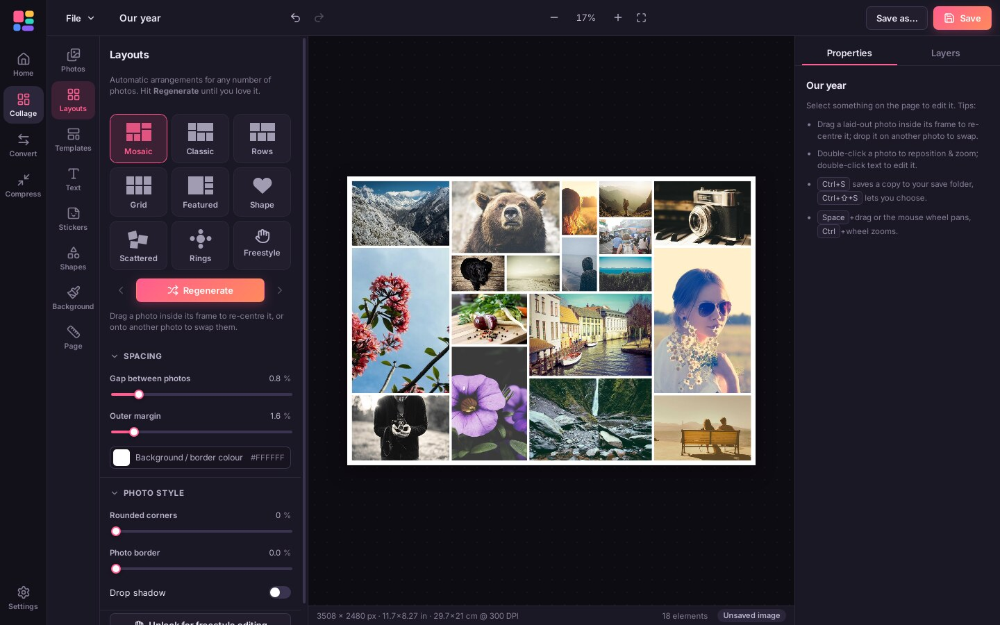

</div>

> A *tessera* is a single tile of a mosaic — and in a collage, every photo is one.

> [!NOTE]
> Tessera is in **alpha**. Everything described below works, but expect rough
> edges, and keep your original photos (Tessera never modifies them unless you
> explicitly choose “Replace” in the converter).

## Two ways to run it

| | Desktop app | Web app (Docker) |
| --- | --- | --- |
| For | your own computer | a home server, a NAS: use it from any browser on your network |
| Install | deb, rpm, Flatpak or AppImage ([below](#install)) | `docker compose up -d` ([Docker guide](docs/DOCKER.md)) |
| Your photos | folders you choose on first start | folders mounted into the container |
| Everything below | ✅ | ✅ |

Both are the same program: the desktop app runs Tessera's engine privately on
your computer and shows it in a window, the web app serves it to browsers.

## What it does

### Library, stories and presentations

*(Formerly the separate app Letopis, now part of Tessera.)*

- **Library** — every photo and video in your library folders, indexed in the
  background: a folder tree, a fast virtualised grid, search, filters (date
  taken, camera, resolution, orientation, duration, places with GPS),
  favourites and recently used, duplicates and look-alikes, hover-scrubbing of
  videos, live/motion photos and a full-screen viewer. Pick photos to start a
  collage or send them to the image tools.
- **Your files stay where they are.** Libraries are **read-only** by default:
  stories only reference the files, and the image tools save to your
  Outputs folder unless you make a library read-write.
- **Stories** — diaries, trip logs and chronicles that mix rich text with
  photos, videos and **live collages**: seven section layouts, captions,
  before/after comparisons, video clip ranges, embeds (YouTube, maps),
  templates, tags, styled titles, find & replace, full version history and
  conflict detection.
- **Diary** — a *Today* entry with today's photos, a calendar of stories and
  photos per day, *On this day*, and a story drafted from a trip or a date
  range (a chapter per day, the best photos, captions with date and place).
- **Canvas** — the same story as an infinite whiteboard: cards, notes, text
  in Tessera's styles, stickers, shapes, arrows, frames, pen drawings, groups,
  a minimap and auto-arrange.
- **Presentations** — any document or canvas becomes a slideshow with
  transitions, an overview, a speaker-notes window, timed or looping playback,
  a laser pointer and drawing, background music, rehearsal timing and a phone
  remote (web app).
- **Exports** — PDF, PowerPoint (PPTX), Markdown, an **MP4 slideshow video**
  (also from Library photos or a collage), an offline package, and a backup of
  every story.
- **Video** — every common format plays; videos the viewer can't play (HEVC
  phone clips in some browsers, MKV, AVI…) and very large ones get proxies,
  made on the GPU where possible (VAAPI). GIFs become small looping videos.
- **System** page — indexing queues, cache, GPU status and a stress test;
  <kbd>Ctrl</kbd>+<kbd>K</kbd> opens a command palette everywhere.

### One photo toolkit, everywhere

The same tools in the collage editor, in stories, on the canvas and in the
Library (*Edit a copy* saves a new file and never touches the original):
one-click **Auto**, 20 filter presets, exposure, contrast, highlights and
shadows, vibrance, warmth and tint, clarity, sharpen, blur, grain, fade,
vignette, **duotone** and **colour pop**; crop, turn, straighten and mirror;
**hide faces or number plates** (blur or pixelate); frames (polaroid, film,
tape…), shapes, borders and shadows; and **cut-outs** — remove a photo's
background on your own device and use it as a sticker. Plus memes in one
click, and page sizes for every social network.

### Collages

| Simple & automatic | Hand-crafted | From a template |
| :---: | :---: | :---: |
| 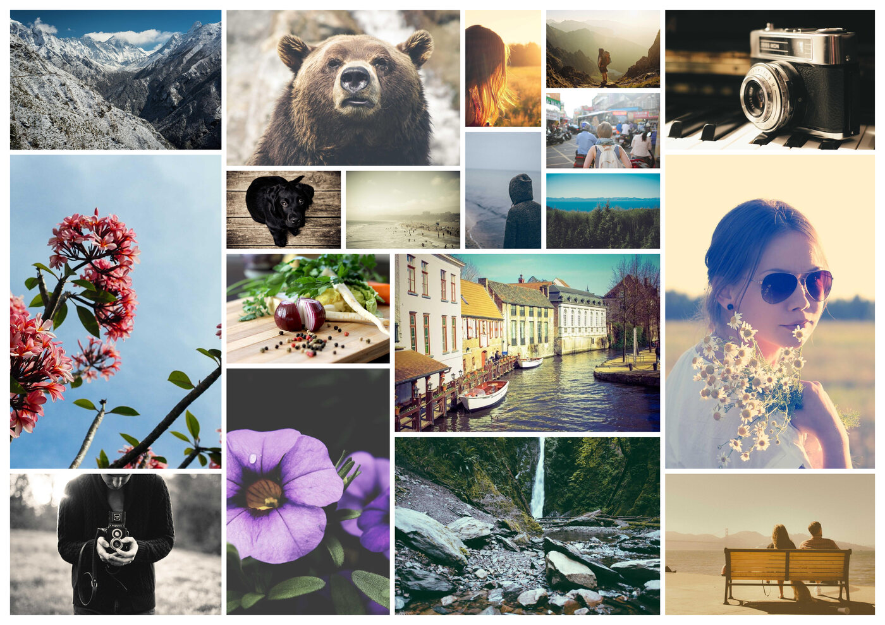 | 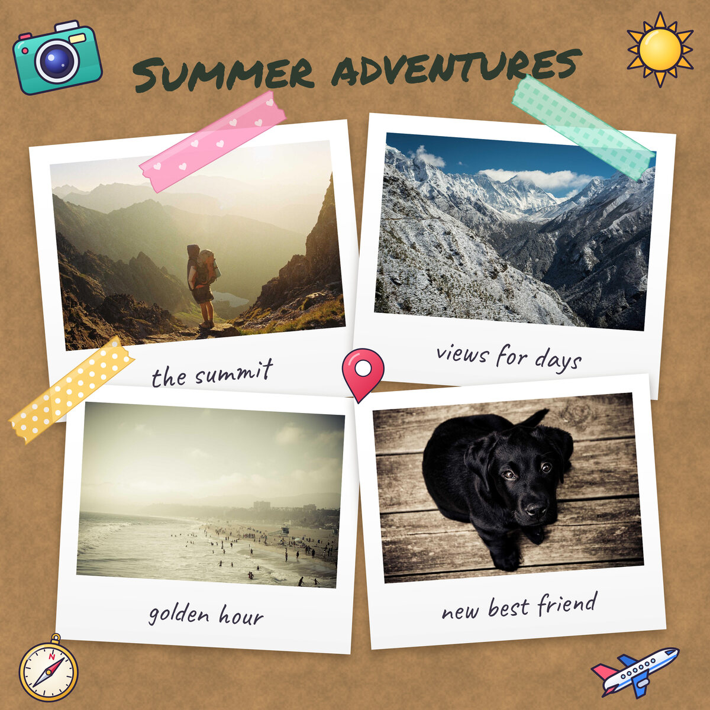 | 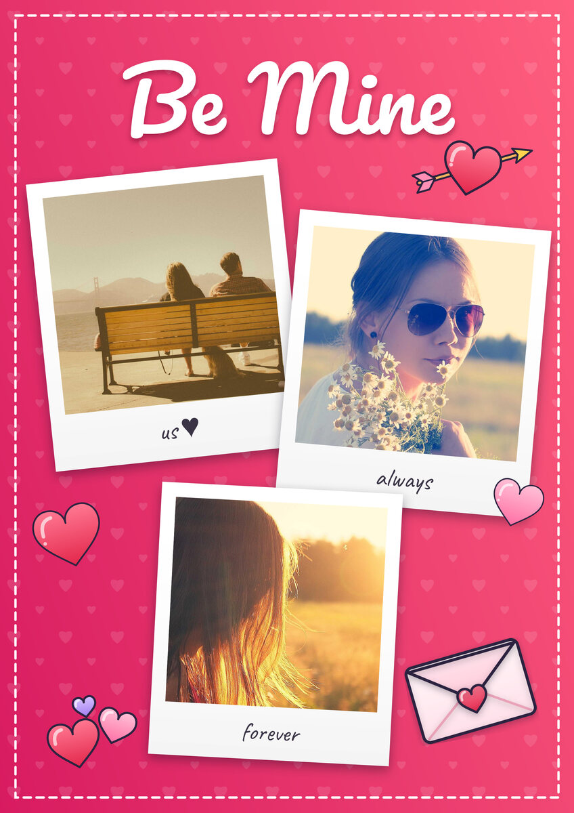 |
| **Heart of Us** (shape layout) | **Merry Christmas** (template) | **Photo Calendar** (template) |
| 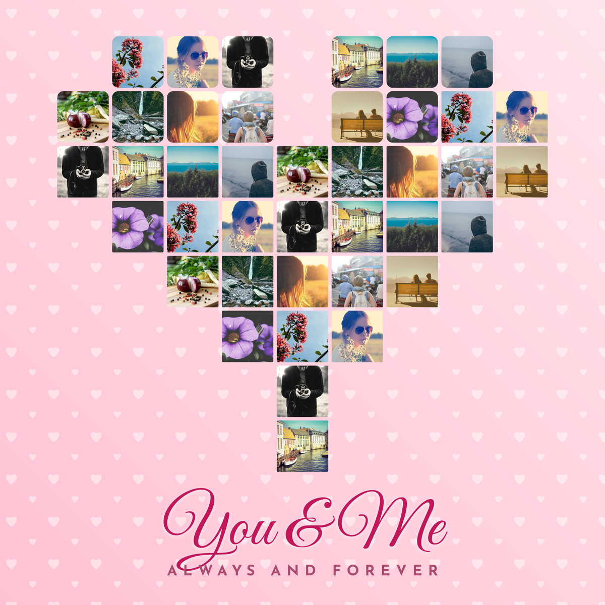 | 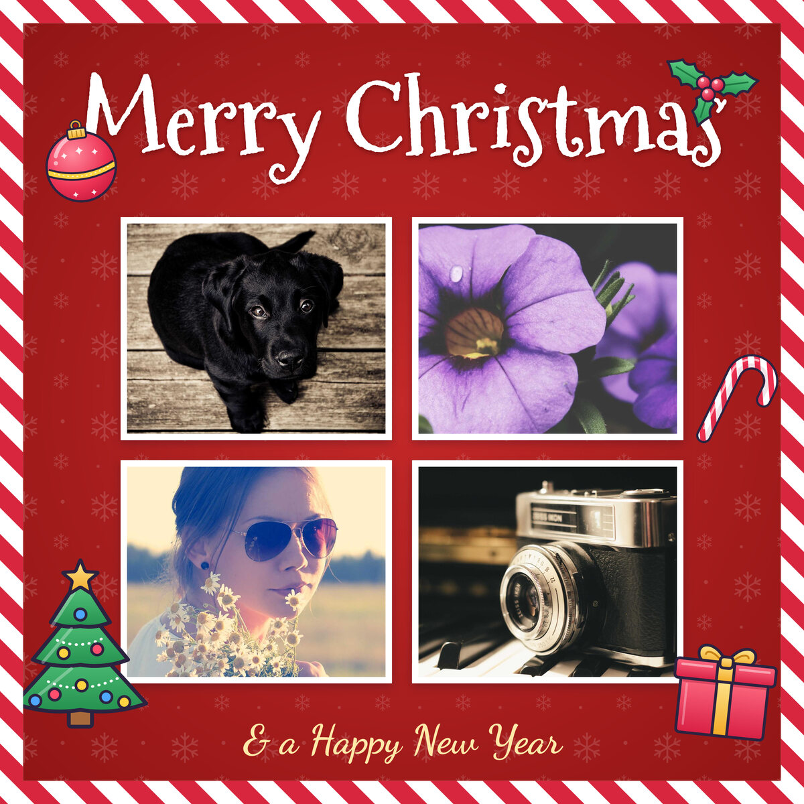 | 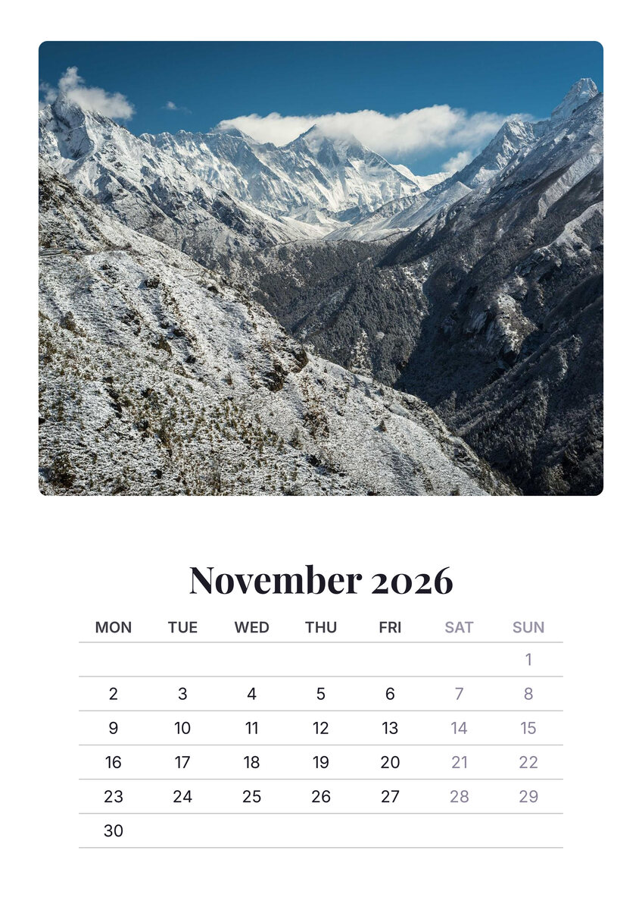 |
| **L-O-V-E** (letters layout) | **The Big Number** (letters layout) | |
| 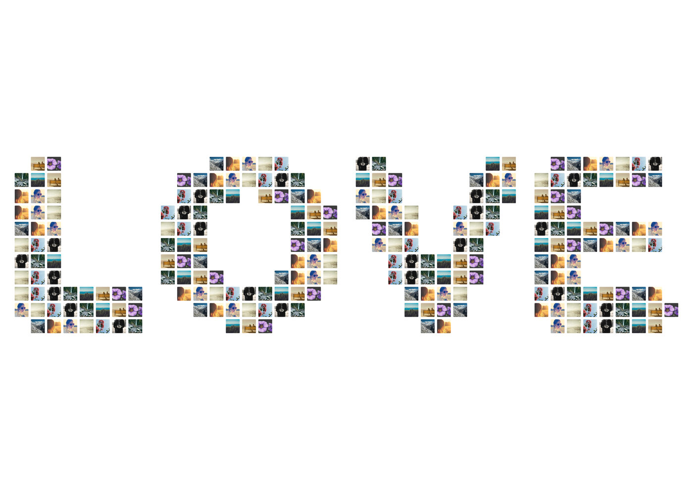 | 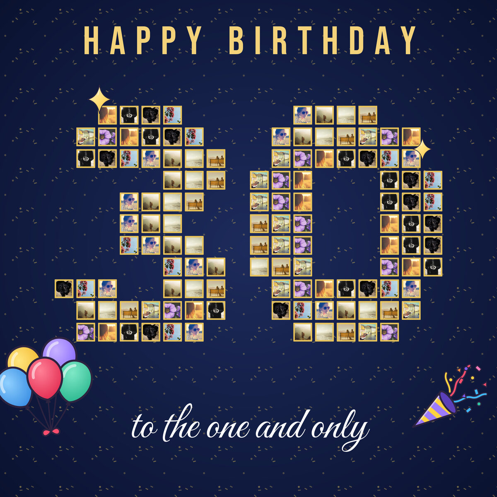 | |

**Photo book** — a cover and varied page layouts, made from a folder of photos in one click:

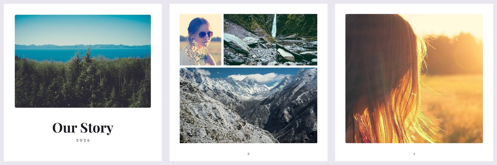

- **Quick collage** — pick any number of photos (dozens or hundreds) and get a
  layout that fills the page. Press **Regenerate** until you love it, and step
  back and forth through previous layouts.
- **Ten layout engines** — *Mosaic* (fills edge to edge with minimal cropping),
  *Classic* (a faithful port of [PhotoCollage](https://github.com/adrienverge/PhotoCollage)’s
  column algorithm), *Rows*, *Grid*, *Featured*, *Shape* (heart, circle, star,
  hexagon, diamond), *Letters* (photos fill any word, name or number),
  *Spiral*, *Scattered polaroids* and *Rings*.
- **Fix it by hand, PhotoCollage-style** — drag a photo inside its frame to
  re-centre it; drop it on another photo to swap them; double-click to zoom and
  reposition.
- **A real editor** — move, resize and rotate anything with snapping guides,
  layers, alignment, undo/redo, copy & paste and keyboard shortcuts.
- **Photo styling** — 14 frame shapes (heart, arch, circle, scallop, cloud…),
  polaroid / instant / film / mat / tape frames with captions, borders, soft
  shadows, filters (B&W, vintage, warm, dreamy…) and adjustments.
- **Text** — 26 bundled fonts (script, handwriting, display, serif…), outline,
  shadow, label backgrounds and **curved text**.
- **Calendars** — add any month with marked birthdays and holidays, or all
  twelve months at once, in four styles; photo-calendar templates included.
- **259 original stickers** — hearts, Christmas, New Year, birthday, Halloween,
  Easter, wedding, baby, graduation, travel, nature, pets, emoji-style faces,
  scrapbook doodles, gold balloon numbers, sports, music, food, space, kids,
  flowers, seasons and animals.
- **Backgrounds** — colours, gradients, 16 patterns, paper textures, a blurred
  photo, vignette and decorative page borders (stitched, candy cane, hearts,
  snowflakes, gold, film strip…).
- **58 templates** for Valentine’s Day and loved ones, anniversaries, Christmas,
  New Year, birthdays, Mother’s and Father’s Day, weddings, new babies, travel,
  Halloween, Easter, autumn, spring, graduation, friends, pets, calendars,
  letters and numbers, and a baby’s first year.
- **Print-ready sizes** — A3, A4, A5, US Letter/Legal, photo prints (4×6″, 5×7″…),
  scrapbook 12×12″ at 72–600 DPI, plus social-media and screen sizes.
- **Multi-page projects** — add, duplicate, reorder and delete pages from the
  page strip under the canvas; any template can go on the current page.
- **Photo books** — pick your photos, a page size and a style (clean white,
  warm paper or dark): Tessera makes a cover and pages with varied layouts and
  page numbers, sorted by the date each photo was taken.
- **Photo calendars** — a cover and twelve month pages from your photos, for
  any year, with the week starting on Monday or Sunday.

### Saving

- **Save** (<kbd>Ctrl</kbd>+<kbd>S</kbd>) writes a copy of your collage into your
  save folder (default: `~/Pictures/Tessera`) — no dialog.
- **Save as…** (<kbd>Ctrl</kbd>+<kbd>Shift</kbd>+<kbd>S</kbd>) lets you choose
  the location, file name, format (JPEG, PNG, WebP, AVIF, TIFF or PDF), quality
  and size. The print DPI is embedded in the file.
- Multi-page projects save every page: one **multi-page PDF**, or numbered
  images (`… - page 01.jpg`). Save as… can also export just the current page.
- **Print** (<kbd>Ctrl</kbd>+<kbd>P</kbd>) opens the system print dialog with
  the paper already set to your page size and no margins, so each page prints
  on exactly one sheet.
- Projects autosave and appear under **Recent** on the home screen; you can also
  save `.tessera` project files anywhere.

### Image tools

- **Convert** between JPEG, PNG, WebP, AVIF, TIFF, BMP, GIF, QOI, ICO and TGA
  (and import HEIC/HEIF, JPEG XL and **camera RAW** files).
  - **RAW:** CR2, CR3, NEF, ARW, DNG, RAF, ORF, RW2, PEF and many more open
    everywhere in Tessera — in collages, the converter and the compressor —
    developed with the camera's white balance and colour matrix.
  - **Colour management:** wide-gamut photos (Display P3 from phones, Adobe RGB
    from cameras) are converted to sRGB through their ICC profile, so they look
    right on every screen and website. Or keep the original profile.
  - **Quality:** keep **100 %** (lossless wherever the format allows — a
    JPEG→JPEG copy never touches the image data) or **lower it by any percentage**.
  - **Metadata:** keep everything, remove everything, or choose: date & time,
    camera / phone, camera settings, location (GPS), author & copyright, colour
    profile, and the file’s modified date.
- **Compress** with a before/after preview:
  - **Smart — visually lossless:** finds the smallest file that still measures as
    identical to the original (SSIM-based search). Typical camera JPEGs shrink
    to around 40 % of their size.
  - Balanced, Small, Lossless-only, custom quality, or **fit under a target file
    size**; optional resize and format change (WebP/AVIF are much smaller).
- **Batch** — resize, watermark and rename many photos in one go, with a live
  preview of the first photo:
  - **Resize** by long edge, width, height or percentage (never enlarged).
  - **Watermark** with text (any font, colour, outline, shadow) or a logo
    image; nine positions or repeated across the photo; size, opacity and
    distance from the edge.
  - **Rename** with a pattern: `{name}`, a counter `{n}`, date and time taken,
    size and folder; sort by name or date, change letter case and spaces.
  - Save copies into a folder or next to the originals, or move the originals.
    A pure rename copies the file byte for byte; originals are never
    overwritten unless you ask for it.

### Screenshots

| | |
| :---: | :---: |
| 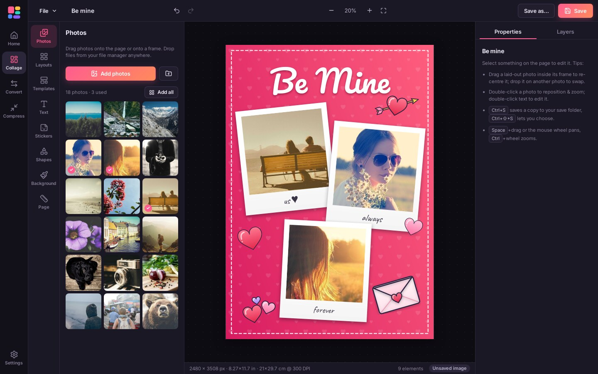 | 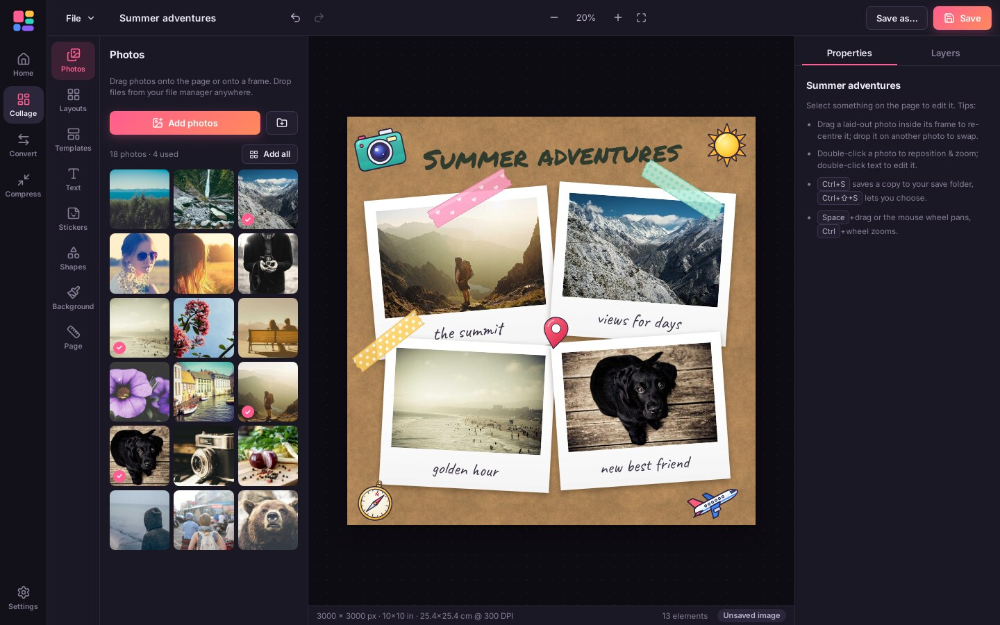 |
| 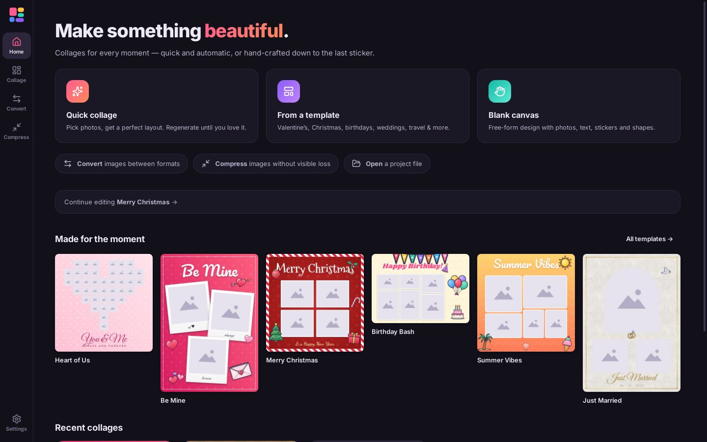 | 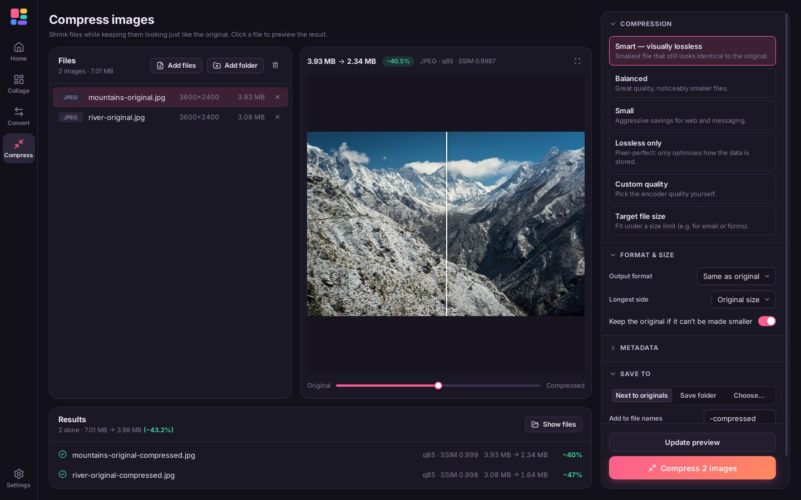 |

## Install

### Desktop

Download the latest file for your system from the
[**Releases** page](https://github.com/MrNechev/tessera/releases).

| System | File | How |
| --- | --- | --- |
| Fedora, openSUSE, RHEL | `.rpm` | `sudo dnf install ./Tessera-*.rpm` |
| Debian, Ubuntu, Mint, Pop!_OS | `.deb` | `sudo apt install ./Tessera_*.deb` |
| Any distribution (sandboxed) | `.flatpak` | `flatpak install --user Tessera_*.flatpak` |
| Any distribution (portable) | `.AppImage` | `chmod +x Tessera_*.AppImage && ./Tessera_*.AppImage` |

The deb, rpm and AppImage need a reasonably recent system (Ubuntu 24.04,
Debian 13, Fedora 40 or newer). The Flatpak runs everywhere Flatpak does.

**HEIC/HEIF photos** (from iPhones) need an HEVC decoder:

- **Flatpak** — included, works out of the box.
- **.deb** — installs `libheif-plugin-libde265` automatically (it's a recommended package).
- **.rpm** — Fedora's libheif has no HEVC decoder for patent reasons; install
  `libheif-freeworld` from RPM Fusion (Bazzite and many Fedora spins already have it).
- **AppImage** — can't open HEIC yet in 0.1.0 (the decoder plugin isn't bundled);
  use the Flatpak, or convert HEIC photos first. This is fixed in the next release.

**Video in the library and documents** uses `ffmpeg` (thumbnails, posters,
proxies, GIF → video) and `libvips` (fast thumbnails) when they are installed:
the deb and rpm recommend them; for the AppImage install them with your package
manager. See [Known limitations](#known-limitations-of-the-desktop-app).

On first start Tessera asks which folders hold your photos and videos (each
read-only or read-write) and where to save what it makes. Change them later in
**Settings → Libraries**.

### Web app (Docker)

```bash
curl -LO https://github.com/MrNechev/tessera/releases/latest/download/docker-compose.yml
curl -L -o .env https://github.com/MrNechev/tessera/releases/latest/download/env.example
nano .env            # password and library folders
docker compose up -d # then open http://<server>:8470
```

The full guide — folders, read-write libraries, uploads and downloads, HTTPS,
GPU, moving from Letopis — is in [docs/DOCKER.md](docs/DOCKER.md).

### Updates

Tessera checks GitHub for new releases once a day (you can turn this off in
Settings; nothing about you or your computer is sent). The Flatpak is updated by
your software centre instead. In-place automatic updates for the AppImage are
planned.

## Known limitations of the desktop app

The desktop window draws Tessera with **WebKitGTK** (the web engine of GNOME),
while the web app runs in your browser. We measured video playback in the
desktop window on an AMD RX 9070 XT with the GNOME 51 runtime (WebKitGTK
2.54, see `docs/ARCHITECTURE.md`):

| Limitation | Details | Workaround / plans |
| --- | --- | --- |
| **Many videos at once** | One or a few videos play perfectly in every common format (H.264, HEVC incl. iPhone MOV, VP9, AV1, up to 4K). With **about 8 videos playing at the same time** only about half keep full speed. | In documents the desktop app plays at most **4** muted/looping videos at once; the others start when you scroll to them. For video-heavy documents and presentations, the web app in a Chromium-based browser has no such limit. A Chromium-based desktop window (Tauri's CEF runtime, when it becomes stable) would remove it. |
| **Codecs depend on your system** (deb, rpm, AppImage) | The window plays what the system's GStreamer plugins can decode: install `gstreamer1.0-libav` (Debian/Ubuntu) or, on Fedora, `gstreamer1-plugin-openh264` / RPM Fusion's codecs for H.264 and HEVC. The Flatpak includes them. | Videos the window can't play get a proxy, if ffmpeg is installed. |
| **No ffmpeg in the Flatpak yet** | Without ffmpeg, library videos have no thumbnails or hover previews and unplayable formats can't be converted (they still play when the window supports them). deb/rpm recommend ffmpeg; AppImage users install it themselves. | Bundling ffmpeg in the Flatpak is planned. |
| **Audio access is required for video** | WebKit's media clock needs an audio output, even for muted videos; without it videos crawl. The packages have it; if you sandbox Tessera yourself, keep PulseAudio/PipeWire access. | — |
| **Phone remote and HTTP/2** | The desktop app only listens on your own computer (127.0.0.1), so the phone remote for presentations isn't available, and pages load over HTTP/1.1. | Use the web app for remote-controlled presentations. A "share on my network" option is planned. |
| **Printing documents** | Collages print through the native print dialog with the exact paper size. Document print layouts use the generic print dialog; WebKitGTK ignores CSS page sizes, so choose the paper size in the dialog. | Export to PDF and print that. |

## Using Tessera

| Action | How |
| --- | --- |
| Re-centre a photo in its frame | Drag it inside the frame, or double-click and drag; scroll to zoom |
| Swap two photos | Drag one onto the other (hold <kbd>Alt</kbd> for free-standing photos) |
| New arrangement | **Regenerate** or <kbd>Ctrl</kbd>+<kbd>R</kbd> — arrows go back/forward |
| Edit text | Double-click it; <kbd>Esc</kbd> when done |
| Move precisely | Arrow keys (with <kbd>Shift</kbd> for bigger steps) |
| Rotate in 15° steps | Hold <kbd>Shift</kbd> while dragging the round handle |
| Pan / zoom the canvas | <kbd>Space</kbd>+drag or scroll / <kbd>Ctrl</kbd>+scroll |
| Undo / redo | <kbd>Ctrl</kbd>+<kbd>Z</kbd> / <kbd>Ctrl</kbd>+<kbd>Shift</kbd>+<kbd>Z</kbd> |
| Duplicate / delete | <kbd>Ctrl</kbd>+<kbd>D</kbd> / <kbd>Del</kbd> |
| Bring forward / send back | <kbd>Ctrl</kbd>+<kbd>]</kbd> / <kbd>Ctrl</kbd>+<kbd>[</kbd> |
| Fit / 100 % | <kbd>Ctrl</kbd>+<kbd>0</kbd> / <kbd>Ctrl</kbd>+<kbd>1</kbd> |

Drop image files or folders anywhere on the window: onto the collage, the
converter or the compressor. You can also open images with Tessera from your
file manager.

## Building from source

You need Node.js 22+, a recent stable Rust toolchain and the Tauri 2 Linux
prerequisites plus libheif and dav1d:

```bash
# Fedora
sudo dnf install webkit2gtk4.1-devel gtk3-devel libsoup3-devel librsvg2-devel \
  libheif-devel libdav1d-devel nasm openssl-devel
# Debian / Ubuntu
sudo apt install libwebkit2gtk-4.1-dev libgtk-3-dev libsoup-3.0-dev librsvg2-dev \
  libheif-dev libdav1d-dev nasm build-essential

npm ci
npm run tauri dev        # run with hot reload
npm run tauri build      # build deb, rpm and AppImage into target/release/bundle
```

The Flatpak is built from [`packaging/flatpak`](packaging/flatpak). See
[CONTRIBUTING.md](CONTRIBUTING.md) for tests and project conventions and
[docs/ARCHITECTURE.md](docs/ARCHITECTURE.md) for how the pieces fit together.

## Roadmap

The full plan, with sizes and reasons, is in **[ROADMAP.md](ROADMAP.md)**. In short:

1. ✅ Collages, templates, RAW and colour management, image tools, multi-page
   projects, printing (0.1–0.5).
2. ✅ **Letopis joins Tessera**: media library, documents, canvas and
   presentations; Tessera as a self-hosted web app in Docker (0.6.0).
3. ✅ **One app, one toolkit** (0.7.0): one home screen, the library inside the
   collage editor, a command palette for everything, Stories with diary
   features and live collages, one photo toolkit in every editor, cut-outs,
   memes, MP4 slideshows.
4. **Still open from 0.6.x/0.7**: a better server file picker, upload
   progress, per-browser video support, ffmpeg in the Flatpak, one image
   engine and cache, version history for collages, a shared interaction layer.
5. **Tessera on a server** (0.8): install as an app, phones and tablets,
   read-only share links, built-in backups, update notices, real HTTPS certificates.
6. **A smarter library** (0.9): more libraries (Immich), a places map, smart
   collections, a story starter.
7. **1.0**: stable formats, translations, Flathub, AppImage updates.

Ideas and bug reports are very welcome — [open an issue](https://github.com/MrNechev/tessera/issues).

## License & credits

Tessera is free software: you can redistribute it and/or modify it under the
terms of the [GNU General Public License v3](LICENSE) or (at your option) any
later version.

- The stickers, patterns and templates are original works dedicated to the
  public domain ([CC0 1.0](public/stickers/LICENSE.md)), so everything you make
  with them is entirely yours.
- Fonts are licensed under the SIL Open Font License 1.1 or Apache 2.0 — see
  [`public/fonts/licenses`](public/fonts/licenses).
- Cut-outs use the U²-Netp model by Xuebin Qin et al. (Apache 2.0, see
  [`public/models`](public/models/LICENSE.md)) on
  [onnxruntime-web](https://github.com/microsoft/onnxruntime) (MIT).
- The *Classic* layout is a port of the algorithm from
  [PhotoCollage](https://github.com/adrienverge/PhotoCollage) by Adrien Vergé
  (GPL-2.0-or-later), which inspired this project.
- Sample photos in the screenshots are from [Unsplash](https://unsplash.com)
  via [Lorem Picsum](https://picsum.photos).
- Built with [Tauri](https://tauri.app), [Svelte](https://svelte.dev), [axum](https://github.com/tokio-rs/axum),
  [SQLite](https://sqlite.org), [FFmpeg](https://ffmpeg.org), [libvips](https://www.libvips.org),
  [TipTap](https://tiptap.dev), [PptxGenJS](https://gitbrent.github.io/PptxGenJS/),
  [mozjpeg](https://github.com/mozilla/mozjpeg), [libwebp](https://chromium.googlesource.com/webm/libwebp),
  [rav1e](https://github.com/xiph/rav1e), [oxipng](https://github.com/shssoichiro/oxipng),
  [libimagequant](https://pngquant.org/lib/), [libheif](https://github.com/strukturag/libheif),
  [jxl-oxide](https://github.com/tirr-c/jxl-oxide), [rawler](https://github.com/dnglab/dnglab)
  (LGPL-2.1, camera RAW), [moxcms](https://github.com/awxkee/moxcms) (colour management)
  and [Lucide](https://lucide.dev) icons.
